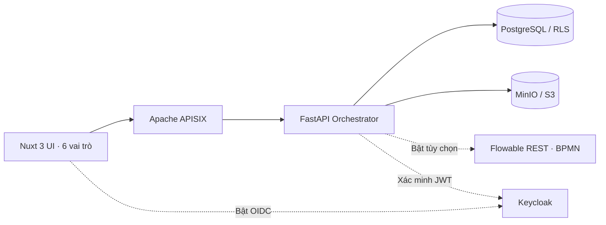

# Kiến trúc và giới hạn bản mã nguồn mẫu

- `core/orchestrator/app/`: API không phụ thuộc Nuxt; quản lý hồ sơ, nhiệm vụ, tài liệu, ledger, pack, đặt lịch, hàng chờ, phản hồi, thống kê.
- `apps/commune/`: một ứng dụng Nuxt 3 sử dụng API; menu, dashboard, hành động khác nhau cho `citizen`, `receptionist`, `officer`, `leader`, `supervisor`, `sys_admin`.
- `core/db/migrations/001_security.sql`: PostgreSQL RLS + `FORCE ROW LEVEL SECURITY` cho các bảng nhiều tenant; app dùng context từ JWT đã xác minh. SQLite chỉ dùng kiểm thử cục bộ, **không có RLS**.
- `packs/`: cấu hình YAML, JSON Schema, BPMN, DMN và wiki, nhập vào DB theo phiên bản bất biến. Checklist và JSON Schema được thực thi bằng Python; DMN được kiểm cú pháp XML nhưng chưa được Flowable DMN thi hành thực sự.
- `core/identity/`: cấu hình ví dụ realm/client/role/claim Keycloak; không có tài khoản chính thức.
- `core/gateway/`: các tuyến APISIX; JWT hiện **được xác minh tại FastAPI**, chưa gắn kiểm tra Keycloak access token ở lớp APISIX. Điều này **chưa đạt đầy đủ tiêu chí kiểm JWT ở gateway** trong README gốc.
- `core/orchestrator/app/flowable.py`: adapter Flowable REST có thể bật bằng `.env`, kiểm tra deployment BPMN theo mã thủ tục. Chưa kiểm chứng trên container trong phiên tạo mã này; cơ chế máy trạng thái Python là mặc định.

## Trạng thái máy nghiệp vụ đã hiện thực

`submitted` → `received` → `in_review` → `pending_signature` → `approved/rejected` → `closed`.

Từ `received`/`in_review` có thể chuyển sang `need_supplement`; sau bổ sung đầy đủ, quay lại `in_review`. Vai trò được kiểm tra tại API. Mỗi bước ghi sự kiện, ký duyệt ghi thêm ledger. **Không phải chữ ký số pháp lý.**

## Ranh giới dữ liệu

- Nhân sự xã chỉ xem tenant ghi trong JWT.
- Công dân chỉ xem hồ sơ được tạo bởi `sub` của chính họ.
- `supervisor` chỉ xem `tenant_metrics` đã loại PII; API xem hồ sơ gốc bị chặn.
- `sys_admin` điều hành tenant và kiểm toán nhưng API không cho mở hồ sơ gốc.
- Bất kỳ báo cáo/CSV đa xã nào cũng xuất từ thống kê tổng hợp, không xuất `applicant`/`form_data`.

## Giới hạn chưa được khẳng định

Chưa có kiểm tra toàn hệ thống bằng Docker Compose, kiểm thử khôi phục dữ liệu, quét mã độc ClamAV trong stack Compose, tích hợp PostgREST, OCR PaddleOCR, embedding/pgvector/LLM RAG, Metabase, chuẩn ký số pháp lý, DMN quyết định động, BPMN song song, đồng bộ webhook, bảo vệ ở gateway và kiểm toán truy cập PII. Xem `FEATURE_MATRIX.md`.
