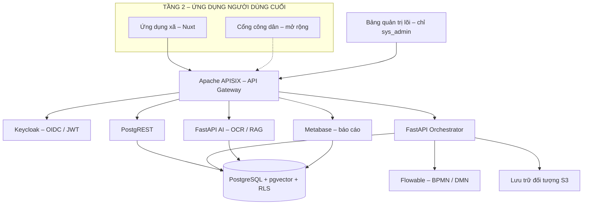
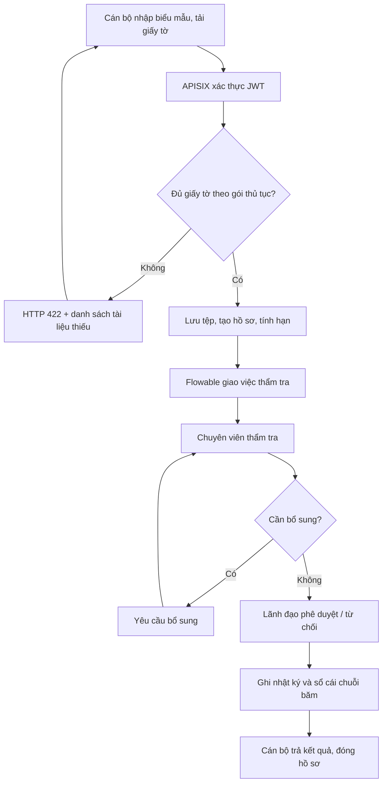

<!-- SPDX-License-Identifier: Apache-2.0 -->

# CommuneOS

### DX-OS Open-Core cho chính quyền cấp xã — Lõi mở, đa thuê ước, vận hành hồ sơ hành chính theo H–P–D–I

> **Một xã có thể tự triển khai nền tảng vận hành số bằng một quy trình cài đặt thống nhất, giảm phụ thuộc vào nhà cung cấp; dữ liệu và các tác vụ AI được thiết kế để xử lý trong hạ tầng do đơn vị kiểm soát.**

**CommuneOS** là đề tài dự thi **Olympic Tin học Sinh viên Việt Nam 2026 – nội dung Phần mềm nguồn mở (OLP PMNM 2026)**, thuộc chủ đề *Xây dựng Hệ điều hành Chuyển đổi số bằng Công nghệ Lõi nguồn mở (DX-OS Open-Core)*.

Dự án đề xuất một **nền tảng dịch vụ lõi dùng chung (Tầng 1)** hoạt động theo kiến trúc *headless*, kết hợp **ứng dụng nghiệp vụ cấp xã (Tầng 2)** để minh họa hành trình số hóa **Human → Process → Data → Intelligence (H–P–D–I)**. Trọng tâm là quản trị hồ sơ hành chính, điều phối quy trình, cách ly dữ liệu giữa các xã, quản trị dựa trên số liệu và trợ lý AI có nguồn dẫn.

> [!IMPORTANT]
> **Trạng thái tài liệu:** README này được xây dựng từ 5 tài liệu đề bài, thể lệ, giới thiệu DX-OS, lộ trình và đặc tả kỹ thuật do nhóm cung cấp ngày 11/11/2026. Đây là **README theo đặc tả/định hướng triển khai**, không phải biên bản xác nhận mã nguồn đã chạy. Nhóm cần đối chiếu với repository thực tế, cập nhật các mục đánh dấu **`[CẦN CẬP NHẬT]`**, và chỉ công bố tính năng đã kiểm thử trước khi phát hành.

| Thông tin | Nội dung |
|---|---|
| Tên sản phẩm | **CommuneOS** |
| Định vị | DX-OS Open-Core cho chính quyền cơ sở |
| Tên kho mã nguồn dự kiến | `commune-os` |
| Cuộc thi | OLP PMNM 2026 |
| Bản phát hành mục tiêu | `v1.0.0` – 25/11/2026 (theo lộ trình nội bộ) |
| Giấy phép dự kiến cho mã do nhóm tự phát triển | **Apache License 2.0**; cần có tệp `LICENSE` toàn văn |
| Nhóm phát triển | **[CẦN CẬP NHẬT: tên đội, trường, thành viên]** |
| Kho mã nguồn / trang demo | **[CẦN CẬP NHẬT: URL sau khi công bố]** |

---

## Mục lục

1. [Bài toán và mục tiêu](#1-bài-toán-và-mục-tiêu)
2. [Phạm vi và điểm khác biệt](#2-phạm-vi-và-điểm-khác-biệt)
3. [Đối chiếu kiến trúc DX-OS và H–P–D–I](#3-đối-chiếu-kiến-trúc-dx-os-và-hpdi)
4. [Kiến trúc tổng thể](#4-kiến-trúc-tổng-thể)
5. [Thành phần công nghệ](#5-thành-phần-công-nghệ)
6. [Cấu trúc kho mã nguồn](#6-cấu-trúc-kho-mã-nguồn)
7. [Vai trò và phân quyền](#7-vai-trò-và-phân-quyền)
8. [Luồng xử lý và trạng thái hồ sơ](#8-luồng-xử-lý-và-trạng-thái-hồ-sơ)
9. [Mô hình dữ liệu và bảo mật đa xã](#9-mô-hình-dữ-liệu-và-bảo-mật-đa-xã)
10. [Hợp đồng API của lõi](#10-hợp-đồng-api-của-lõi)
11. [Gói thủ tục không cần sửa mã](#11-gói-thủ-tục-không-cần-sửa-mã)
12. [AI hỗ trợ cán bộ và sổ cái kiểm toán](#12-ai-hỗ-trợ-cán-bộ-và-sổ-cái-kiểm-toán)
13. [Cài đặt và chạy từ mã nguồn](#13-cài-đặt-và-chạy-từ-mã-nguồn)
14. [Kiểm thử và nghiệm thu](#14-kiểm-thử-và-nghiệm-thu)
15. [Kịch bản trình diễn trước Ban Giám khảo](#15-kịch-bản-trình-diễn-trước-ban-giám-khảo)
16. [An toàn thông tin và giới hạn sử dụng](#16-an-toàn-thông-tin-và-giới-hạn-sử-dụng)
17. [Giấy phép, phụ thuộc và phát hành](#17-giấy-phép-phụ-thuộc-và-phát-hành)
18. [Đóng góp và phát triển cộng đồng](#18-đóng-góp-và-phát-triển-cộng-đồng)
19. [Lộ trình và định hướng phát triển](#19-lộ-trình-và-định-hướng-phát-triển)
20. [Đối chiếu tiêu chí chấm OLP PMNM 2026](#20-đối-chiếu-tiêu-chí-chấm-olp-pmnm-2026)
21. [Tài liệu tham chiếu và thông tin cuộc thi](#21-tài-liệu-tham-chiếu-và-thông-tin-cuộc-thi)

## 1. Bài toán và mục tiêu

Chuyển đổi số dễ gặp hai tình trạng: triển khai nhiều phần mềm rời rạc tạo **ốc đảo dữ liệu**, hoặc phụ thuộc vào một hệ thống nguyên khối khó thay đổi. Đối với đơn vị hành chính cấp xã, các vấn đề này còn biểu hiện ở việc tiếp nhận hồ sơ thiếu giấy tờ, chuyển xử lý thủ công, khó theo dõi quá hạn và khó đối soát lịch sử quyết định.

CommuneOS hướng tới:

- **Lõi nền tảng dùng lại được:** một lần xây dựng các năng lực xác thực, API, dữ liệu, tệp, quy trình; nhiều ứng dụng nghiệp vụ có thể sử dụng chung.
- **Không phụ thuộc giao diện:** có thể kiểm chứng lõi qua REST API ngay cả khi chưa khởi động ứng dụng cấp xã.
- **Quy trình có rào chắn lỗi:** hồ sơ thiếu tài liệu bắt buộc được phát hiện trước khi tiếp nhận, theo nguyên tắc *Poka-yoke*.
- **Dữ liệu có phạm vi rõ ràng:** từng xã là một *tenant*; chính sách PostgreSQL Row-Level Security (RLS) là lớp cách ly cuối cùng.
- **Điều hành bằng dữ liệu:** theo dõi hồ sơ, trạng thái, thời hạn xử lý và các trường hợp trễ hạn.
- **AI có trách nhiệm:** OCR và trợ lý hỏi đáp RAG chỉ gợi ý; cán bộ luôn kiểm tra, quyết định và chịu trách nhiệm nghiệp vụ.
- **Minh bạch, có thể tái lập:** xây dựng từ mã nguồn mở, cấu hình bằng tệp, công bố mã nguồn, lịch sử phát hành, giấy phép và tài liệu.

CommuneOS **không được giới thiệu là hệ thống thay thế Cổng Dịch vụ công**, cũng không mặc nhiên là một sản phẩm chính thức của cơ quan nhà nước.

## 2. Phạm vi và điểm khác biệt

### 2.1. Phạm vi sản phẩm mục tiêu

| Hạng mục | Mức ưu tiên theo tài liệu | Minh họa |
|---|---|---|
| Lõi headless gồm định danh, cổng API, dữ liệu, tệp và workflow | **Bắt buộc** | Độc lập ứng dụng, gọi API bằng `curl` |
| Ứng dụng xử lý hồ sơ cấp xã | **Bắt buộc** | Hồ sơ đăng ký khai sinh chạy trọn vòng |
| Cách ly dữ liệu hai xã | **Bắt buộc** | Tài khoản xã A không đọc được hồ sơ xã B |
| Bảng quản trị lõi | **Mục tiêu bản v1.0.0** | Quản lý xã, nạp gói thủ tục, kiểm toán, tình trạng dịch vụ |
| Hồ sơ đăng ký hộ kinh doanh | **Gói thứ hai theo thiết kế** | Quy trình cấu hình, có hạn xử lý |
| Dashboard cấp xã và cấp trên | **Mục tiêu bản v1.0.0** | Trễ hạn, tổng hợp liên xã đã loại PII |
| RAG tra cứu quy trình | **Mục tiêu bản v1.0.0** | Trả lời dựa trên wiki, dẫn nguồn |
| OCR giấy tờ mẫu | **Ưu tiên sau lõi/quy trình** | Gợi ý điền biểu mẫu từ giấy tờ giả lập |
| Nạp gói “xác nhận cư trú” trực tiếp | **Màn chứng minh khả năng mở rộng** | Tạo thủ tục mới không viết mã ứng dụng |
| Kênh nộp hồ sơ online của công dân | **Mở rộng đã được đặc tả** | Ứng dụng `apps/citizen/` riêng |
| Ứng dụng mobile, WebGIS, thanh toán, ký số pháp lý | **Ngoài phạm vi bản rút gọn** | Định hướng phát triển |

**Mức ưu tiên triển khai khi thời gian hạn chế:** lõi headless → hồ sơ khai sinh hoàn chỉnh → cài đặt/tài liệu/PoF → quản trị và dashboard → RAG → gói thứ hai → OCR.

### 2.2. Điểm khác biệt kỹ thuật

1. **Tách dứt khoát `core/` và `apps/`:** ứng dụng chỉ sử dụng hợp đồng API; lõi không phụ thuộc mã giao diện nghiệp vụ.
2. **Thủ tục là cấu hình:** một gói thủ tục bao gồm YAML, BPMN, JSON Schema, DMN và Markdown wiki; có thể nạp phiên bản mới mà không viết lại lõi.
3. **Chặn lỗi từ đầu:** kiểm tra giấy tờ trước khi hồ sơ bước vào luồng xử lý tại quầy.
4. **Đa thuê ước tại cấp cơ sở dữ liệu:** quyền truy cập không chỉ dựa trên việc ẩn nút ở giao diện.
5. **Sổ cái chuỗi băm theo từng xã:** phát hiện thay đổi dữ liệu lịch sử, song **không tự nhận là chữ ký số hợp pháp**.
6. **RAG dùng lại tri thức của gói thủ tục:** tài liệu hướng dẫn vừa phục vụ con người vừa làm nguồn dẫn cho AI.

## 3. Đối chiếu kiến trúc DX-OS và H–P–D–I

Đề thi mô tả kiến trúc DX-OS **ba tầng**. Phạm vi bài thực hành yêu cầu triển khai **Tầng 1 (dịch vụ lõi)** và **ít nhất một ứng dụng minh họa ở Tầng 2**. Tầng 3 là nơi kết nối những ứng dụng nghiệp vụ chuyên ngành trong tương lai, không phải một tầng bắt buộc phải triển khai đầy đủ trong bài thi này.

| Tầng DX-OS | Vai trò | Thành phần CommuneOS |
|---|---|---|
| **Tầng 1 – Nền tảng Dịch vụ Lõi số** | PaaS, cung cấp dịch vụ chung; headless đối với người dùng cuối | `core/`: Keycloak, APISIX, PostgreSQL/PostgREST, lưu trữ S3, Flowable, orchestrator, AI; `core/admin/` là bảng quản trị kỹ thuật |
| **Tầng 2 – Không gian Năng lực số** | Giao diện và năng lực tác nghiệp H–P–D–I | `apps/commune/` và các trang thống kê/điều hành |
| **Tầng 3 – Nền tảng nghiệp vụ chuyên ngành** | Các ứng dụng chuyên sâu cắm-rút theo API | Khả năng tích hợp mở rộng; **không tuyên bố đã triển khai** |

### Bốn không gian H–P–D–I trong ứng dụng cấp xã

| Không gian | Ý nghĩa | Ví dụ minh họa |
|---|---|---|
| **H – Human (Con người số)** | Làm việc số và định danh tập trung | SSO, vai trò cán bộ, hàng chờ công việc, kho hướng dẫn thủ tục |
| **P – Process (Quy trình số)** | Chuẩn hóa, điều phối, ngăn lỗi | BPMN/DMN, kiểm tra giấy tờ Poka-yoke, giao việc, hạn xử lý |
| **D – Data (Dữ liệu số)** | Dữ liệu nhất quán và điều hành dựa trên số liệu | RLS, nhật ký sự kiện, view thống kê, dashboard xã và cấp trên |
| **I – Intelligence (Trí tuệ số)** | Hỗ trợ tác nghiệp bằng AI | OCR và hỏi đáp RAG có dẫn nguồn, human-in-the-loop |

### Đối chiếu bốn năng lực lõi bắt buộc của đề thi

| Yêu cầu | Công nghệ lựa chọn | Cách chứng minh |
|---|---|---|
| Identity/SSO | Keycloak + OIDC/JWT | Đăng nhập, kiểm chứng vai trò và claim `tenant_id` |
| API Gateway | Apache APISIX | Gọi tuyến bảo vệ không có JWT trả `401` |
| Dữ liệu có cấu trúc và phi cấu trúc | PostgreSQL/PostgREST + kho tệp S3-compatible | API dữ liệu, RLS theo xã, giấy tờ lưu riêng |
| Workflow Engine | Flowable BPMN/DMN | Hồ sơ chuyển bước và áp dụng cấu hình gói thủ tục |

**Các nguyên lý mở rộng của đề thi:** tách dữ liệu nóng/lạnh, hội tụ IT/OT, phả hệ dữ liệu và Zero-Trust/GitOps là các định hướng cần có bằng chứng theo mức độ thực hiện. Bản 14 ngày rút gọn sử dụng PostgreSQL view thay cho kho lạnh Parquet/DuckDB, chưa triển khai hội tụ IT/OT, và dùng Docker Compose/cấu hình dạng mã thay cho một hệ thống GitOps Kubernetes đầy đủ.

## 4. Kiến trúc tổng thể



**Nguyên tắc bất biến:**

- Mọi yêu cầu từ giao diện đến các dịch vụ đi qua **APISIX**. Không cho giao diện kết nối thẳng PostgreSQL hoặc Flowable.
- Chỉ cửa ngõ được công bố ra bên ngoài; các dịch vụ còn lại dùng mạng nội bộ Compose (trừ các cổng quản trị tạm thời phục vụ phát triển nếu được cấu hình có kiểm soát).
- `apps/` chỉ biết API của `core/`, còn `core/` không biết giao diện thuộc ứng dụng nào.
- `core/` phải có thể khởi động và kiểm thử độc lập với `apps/`.
- `core/admin/` là **giao diện quản trị hệ thống**, không phải giao diện nghiệp vụ người dùng cuối; cách phân tách này giữ tính headless của các dịch vụ lõi.
- Kết nối sử dụng chuẩn mở như **OIDC, REST/OpenAPI, S3 API, BPMN/DMN, SQL** để giảm khóa chặt vào một nhà cung cấp.

## 5. Thành phần công nghệ

Danh sách bên dưới là **lựa chọn kiến trúc từ đặc tả**, không phải xác nhận tất cả container đã tồn tại. Phiên bản chính xác và giấy phép của từng bản phát hành phải ghi trong `DEPENDENCIES.md` sau khi khóa phụ thuộc.

| Thành phần | Công nghệ | Nhiệm vụ |
|---|---|---|
| API gateway (`gateway`) | Apache APISIX | Kiểm JWT, định tuyến, rate limiting |
| Định danh (`identity`) | Keycloak | OIDC, đăng nhập tập trung, JWT, eID mô phỏng |
| CSDL (`db`) | PostgreSQL + pgvector | Dữ liệu giao dịch, RLS, sự kiện, sổ cái, vector |
| Data API (`rest`) | PostgREST | Sinh REST API từ cơ sở dữ liệu với phân quyền |
| Kho hồ sơ (`storage`) | SeaweedFS **hoặc** MinIO | Tệp đối tượng theo giao diện S3 |
| Quy trình (`workflow`) | Flowable | Thi hành BPMN, bảng quyết định DMN và giao việc |
| Điều phối (`orchestrator`) | Python + FastAPI | Kiểm biểu mẫu, tiếp nhận hồ sơ, gọi quy trình, ghi sổ cái, nạp gói |
| AI (`ai`) | Python + FastAPI, Ollama, PaddleOCR | OCR, RAG, khử/che PII |
| Báo cáo (`bi`) | Metabase | Dashboard theo xã và tổng hợp cấp trên |
| Quản trị (`admin`) | Nuxt + TypeScript | Quản trị lõi cho `sys_admin` |
| Ứng dụng xã (`commune`) | Nuxt + TypeScript | Các màn hình tiếp nhận, thẩm tra, ký, trả kết quả |
| Quét tệp công khai | ClamAV | **Bắt buộc trước khi lưu tệp khi bật kênh công dân online** |

**Ngôn ngữ phát triển chủ đạo:** TypeScript, Python, SQL/PL/pgSQL; sử dụng YAML, JSON Schema, BPMN 2.0, DMN và Dockerfile cho cấu hình.

## 6. Cấu trúc kho mã nguồn

Cấu trúc đề xuất cho bản `v1.0.0`:

```text
commune-os/
├── LICENSE                       # Toàn văn Apache License 2.0 cho mã của nhóm
├── README.md                     # Tài liệu chính
├── CHANGELOG.md                  # Lịch sử thay đổi theo phiên bản
├── DEPENDENCIES.md               # Phụ thuộc, phiên bản, giấy phép và nguồn
├── CONTRIBUTING.md               # Hướng dẫn đóng góp
├── Makefile                      # make up / test / seed / backup
├── .env.example                  # Mẫu cấu hình KHÔNG chứa bí mật thật
├── docker-compose.yml            # Cấu hình hệ thống container
├── core/                         # TẦNG 1: NỀN TẢNG LÕI
│   ├── gateway/                  # Định tuyến, JWT và giới hạn API trong APISIX
│   ├── identity/                 # Cấu hình/realm Keycloak, eID mô phỏng
│   ├── db/
│   │   ├── migrations/           # SQL lược đồ, RLS, ledger, view
│   │   └── seed/                 # Hai xã và hồ sơ giả lập
│   ├── orchestrator/             # FastAPI điều phối nghiệp vụ
│   ├── ai/                       # FastAPI OCR và RAG
│   ├── admin/                    # Nuxt: bảng quản trị lõi
│   └── tests/                    # Kiểm thử API và cách ly tenant
├── apps/                         # TẦNG 2: ỨNG DỤNG
│   └── commune/                  # Nuxt: ứng dụng cán bộ và lãnh đạo xã
├── packs/                        # GÓI THỦ TỤC ĐỘC LẬP
│   ├── khai-sinh/
│   └── ho-kinh-doanh/
├── docs/                         # Kiến trúc, OpenAPI, hướng dẫn tạo gói mới
└── .github/
    └── workflows/                # CI kiểm thử, kiểm tra giấy phép
```

**Phần mở rộng kênh công dân:** bổ sung `apps/citizen/` mà không tái cấu trúc `core/`. Một gói demo “xác nhận cư trú” có thể được thêm dưới `packs/` khi được chuẩn bị và kiểm chứng nghiệp vụ.

## 7. Vai trò và phân quyền

| Vai trò | Keycloak role | Giao diện | Quyền nghiệp vụ chính |
|---|---|---|---|
| Quản trị hệ thống | `sys_admin` | Bảng quản trị lõi | Tạo/khóa xã, nạp gói, đối soát ledger, xem tình trạng dịch vụ |
| Cán bộ tiếp nhận | `receptionist` | Ứng dụng xã | Tiếp nhận, tải giấy tờ, xác nhận OCR, trả kết quả |
| Chuyên viên | `officer` | Ứng dụng xã | Thẩm tra, yêu cầu bổ sung, trình ký, hỏi trợ lý |
| Lãnh đạo xã | `leader` | Ứng dụng xã | Phê duyệt/từ chối, dashboard xã, kiểm tra sổ cái |
| Cấp trên | `supervisor` | Trang tổng hợp | Chỉ xem thống kê nhiều xã **không chứa PII**, không mở hồ sơ |
| Công dân – **mở rộng** | `citizen` | Ứng dụng công dân | Nộp và theo dõi **hồ sơ do chính mình tạo** |

`tenant_id` và `role` được gắn vào JWT bởi Keycloak. Hệ thống phải **kiểm soát quyền ở gateway, API và cơ sở dữ liệu**, không tin vào thông tin tenant truyền tùy ý từ trình duyệt.

## 8. Luồng xử lý và trạng thái hồ sơ

### 8.1. Tiếp nhận hồ sơ tại quầy



Theo đặc tả, chu trình tiếp nhận gồm 8 hoạt động chính:

1. Ứng dụng xã gửi biểu mẫu, tệp và JWT đến gateway.
2. Gateway kiểm tra token trước khi chuyển yêu cầu đến orchestrator.
3. Orchestrator đối chiếu giấy tờ với checklist/DMN; thiếu giấy tờ thì trả **HTTP `422`** cùng danh sách còn thiếu, **không khởi động quy trình**.
4. Hồ sơ hợp lệ được lưu tài liệu vào object storage, lưu thông tin vào PostgreSQL và tính thời hạn.
5. Orchestrator khởi động BPMN trên Flowable; công việc được chuyển cho vai tiếp theo.
6. Mỗi lần chuyển trạng thái, hệ thống bổ sung một bản ghi sự kiện (*append-only*).
7. Khi lãnh đạo ra quyết định, hệ thống tạo dấu vết kiểm toán qua mã băm và sổ cái.
8. Cán bộ trả kết quả và đóng hồ sơ.

**Cảnh báo quá hạn** phải theo dõi cả giai đoạn thẩm tra và giai đoạn chờ ký duyệt. Giá trị SLA phụ thuộc gói thủ tục và cần xác minh theo quy định nghiệp vụ hiện hành.

### 8.2. Trạng thái hồ sơ

| Trạng thái | Ý nghĩa |
|---|---|
| `received` | Đã tiếp nhận hợp lệ tại quầy hoặc đã được chấp nhận từ kênh online |
| `in_review` | Chuyên viên đang thẩm tra |
| `need_supplement` | Yêu cầu cung cấp/bổ sung thông tin |
| `pending_signature` | Đang chờ lãnh đạo ra quyết định |
| `approved` | Hồ sơ được phê duyệt, có dấu vết kiểm toán |
| `rejected` | Hồ sơ bị từ chối, có dấu vết kiểm toán |
| `closed` | Đã trả kết quả và đóng hồ sơ |
| `submitted` – **mở rộng** | Công dân vừa nộp hồ sơ trực tuyến, chưa được cán bộ tiếp nhận |

Hồ sơ bị trả lại tại bước kiểm tra đầu vào chưa đi vào các trạng thái tác nghiệp của quy trình; ứng dụng phải hiển thị lý do để cán bộ hoặc công dân điều chỉnh.

### 8.3. Kênh công dân trực tuyến (thiết kế mở rộng)

1. Công dân đăng nhập qua **nhà cung cấp OIDC/eID mô phỏng**, chọn xã và thủ tục cho phép `online`.
2. Điền biểu mẫu, tải giấy tờ; điểm kiểm Poka-yoke áp dụng như tại quầy.
3. Hồ sơ được ghi nhận ở trạng thái `submitted`; trả mã hồ sơ.
4. Cán bộ tiếp nhận duyệt hàng chờ: chấp nhận → `received` và bắt đầu tính SLA; chưa đạt → `need_supplement` kèm lý do.
5. Các bước còn lại dùng **nguyên lõi** đang phục vụ tiếp nhận tại quầy.
6. Công dân tra cứu tình trạng hồ sơ của mình; việc đối chiếu bản chính và trả kết quả tuân theo quy trình demo đã thiết kế.

Kênh công dân **không mặc định bật trong bản rút gọn**. Chỉ mở Internet khi đã có xác thực, giới hạn tần suất/dung lượng/loại tệp, quét mã độc ClamAV trước khi lưu, kiểm soát RLS theo `submitted_by` và đánh giá an toàn.

## 9. Mô hình dữ liệu và bảo mật đa xã

### 9.1. Các bảng và view được đặc tả

| Đối tượng | Chức năng và các trường tiêu biểu |
|---|---|
| `tenants` | Danh mục xã: `id`, `code`, `name`, `status`; chỉ quản trị hệ thống được thay đổi |
| `procedures` | Danh mục thủ tục: `code`, `version`, `name`, `sla_hours`, `checklist` |
| `dossiers` | Hồ sơ: `id`, `tenant_id`, `procedure_code`, `status`, `applicant`, `form_data`, `process_instance_id`, `received_at`, `due_at`, `closed_at` |
| `documents` | Tham chiếu tệp: `id`, `dossier_id`, `tenant_id`, `doc_type`, `object_key`, `sha256` |
| `dossier_events` | Lịch sử bất biến theo hướng ghi thêm: `id`, `dossier_id`, `tenant_id`, `actor`, `action`, `from_status`, `to_status`, `at` |
| `ledger` | Chuỗi băm: `seq`, `tenant_id`, `dossier_id`, `payload_hash`, `prev_hash`, `entry_hash`, `signed_by`, `signed_at` |
| `kb_chunks` | Đoạn kiến thức cho RAG: `id`, `procedure_code`, `source`, `content`, `embedding` |
| `v_dossier_stats` (view) | Thống kê từ `tenant_id`, `procedure_code`, `status` và các mốc thời gian; **không hiển thị PII** |

Đặc tả đề cập **7 bảng + 1 view**. `tenants` là bảng danh mục toàn hệ thống; phạm vi RLS/tenant của `procedures` và `kb_chunks` cần được triển khai nhất quán với cách quản lý gói toàn cục. Các bảng hồ sơ, tài liệu, sự kiện và sổ cái phải có cách ly theo `tenant_id`.

**Kênh online mở rộng:** bổ sung `channel` (`counter` / `online`) và `submitted_by` vào `dossiers`; chính sách RLS riêng cho `citizen` chỉ cho phép truy xuất hồ sơ chính họ nộp.

### 9.2. Chuỗi bảo vệ truy cập

1. Người dùng đăng nhập qua Keycloak bằng OIDC.
2. JWT chứa `tenant_id` và `role` tương ứng với quyền được cấp.
3. APISIX xác thực chữ ký, hiệu lực token; yêu cầu thiếu hoặc sai token tới tuyến bảo vệ bị từ chối `401`.
4. PostgREST truyền ngữ cảnh JWT đã xác minh vào phiên PostgreSQL với vai phù hợp.
5. Chính sách **Row-Level Security** lọc dữ liệu đến từng dòng.
6. `supervisor` chỉ được đọc view thống kê đã loại bỏ PII, **không có quyền đọc bảng `dossiers`**.

Ví dụ **minh họa nguyên lý RLS** của bảng hồ sơ (SQL thực tế phải tương thích với cách chuyển claim và database role trong hệ thống):

```sql
ALTER TABLE dossiers ENABLE ROW LEVEL SECURITY;

CREATE POLICY tenant_isolation ON dossiers
  USING (
    tenant_id =
      (current_setting('request.jwt.claims', true)::json ->> 'tenant_id')
  );
```

**Kiểm thử bắt buộc:** khi cán bộ xã A gọi API lấy danh sách hồ sơ của xã B, kết quả không được chứa bất kỳ hồ sơ nào thuộc xã B. Cũng cần xác minh các đường truy cập trực tiếp qua ID, tệp lưu trữ, thống kê và API nghiệp vụ.

### 9.3. Bảo vệ thông tin cá nhân

- Mã định danh, số điện thoại và thông tin riêng tư không xuất hiện trong dashboard liên xã hoặc ngữ cảnh truy vấn RAG sau bước xử lý che PII.
- Giấy tờ được lưu trong kho đối tượng; bản ghi `documents` chỉ giữ khóa tham chiếu và mã băm.
- Dữ liệu demo là **dữ liệu giả lập do nhóm tự tạo**, không sử dụng CCCD hay hồ sơ thật.
- Không dùng quyền quản trị database để phục vụ request nghiệp vụ thông thường vì có thể vô hiệu hiệu quả RLS.

## 10. Hợp đồng API của lõi

Đây là các đường dẫn **đề xuất trong đặc tả**, chưa phải API đã xác minh. Định nghĩa chuẩn cuối cùng cần nằm trong `docs/openapi.yaml` hoặc tệp OpenAPI tương đương; README và mã phải thống nhất với hợp đồng đó.

| Phương thức | Đường dẫn | Mục đích | Vai trò theo đặc tả |
|---|---|---|---|
| `POST` | `/api/dossiers` | Kiểm giấy tờ, tạo hồ sơ và khởi chạy quy trình | `receptionist`; thêm `citizen` nếu bật kênh online |
| `POST` | `/api/dossiers/{id}/documents` | Tải và gắn tài liệu vào hồ sơ | `receptionist` |
| `GET` | `/rest/dossiers` | Tra cứu danh sách hồ sơ được lọc RLS | Cán bộ trong phạm vi xã |
| `GET` | `/api/tasks` | Lấy danh sách công việc được giao | Cán bộ có quyền |
| `POST` | `/api/tasks/{id}/complete` | Hoàn thành bước, chuyển xử lý | `officer`, `receptionist` |
| `POST` | `/api/dossiers/{id}/sign` | Phê duyệt/từ chối, ghi dấu vết sổ cái | `leader` |
| `GET` | `/api/ledger/verify` | Tính lại và kiểm tra chuỗi băm | `sys_admin`, `leader` |
| `POST` | `/api/ai/ocr` | Trích xuất dữ liệu từ ảnh giấy tờ | `receptionist` |
| `POST` | `/api/ai/ask` | Hỏi đáp theo wiki và dẫn nguồn | Cán bộ có quyền |
| `POST` | `/admin/tenants` | Tạo xã/tenant | `sys_admin` |
| `POST` | `/admin/packs` | Nạp gói thủ tục | `sys_admin` |
| `POST` | `/api/dossiers/{id}/accept` – **mở rộng** | Tiếp nhận hồ sơ online | `receptionist` |

> Đặc tả gốc nhóm các đường dẫn quản trị vào cùng một dòng khi đếm “10 điểm cuối”; bảng trên tách từng route để dễ đọc. Phương thức chuyển tệp trong quy trình tạo hồ sơ (multipart hay upload tạm) và schema response/error phải được **chốt trong OpenAPI**, không tự suy diễn từ bảng này.

Ví dụ kiểm tra **một endpoint có yêu cầu JWT** sau khi hệ thống đã chạy:

```bash
# Thay <GATEWAY_PORT> bằng cổng được khai báo trong docker-compose.yml/.env
export BASE_URL="http://localhost:<GATEWAY_PORT>"

# Không gửi JWT: dự kiến 401 đối với endpoint được bảo vệ
curl -i "$BASE_URL/rest/dossiers"

# Gửi access token hợp lệ được cấp sau quá trình đăng nhập
export ACCESS_TOKEN="<JWT_HOP_LE>"
curl -i "$BASE_URL/rest/dossiers" \
  -H "Authorization: Bearer $ACCESS_TOKEN"
```

Không ghi access token thật vào commit, ảnh chụp hay log công khai. **Chỉ số `401` là tiêu chí nghiệm thu**, không phải kết quả chạy được xác nhận trong tài liệu này.

## 11. Gói thủ tục không cần sửa mã

Một gói thủ tục là thư mục cấu hình gồm **5 thành phần logic**:

```text
packs/khai-sinh/
├── pack.yaml                  # Mã, phiên bản, SLA, vai trò, giấy tờ bắt buộc
├── process.bpmn               # Các bước BPMN và vai phụ trách
├── form.schema.json           # JSON Schema để dựng biểu mẫu
├── checklist.dmn              # Quy tắc kiểm tra theo điều kiện
└── wiki/
    └── huong-dan.md           # Hướng dẫn nghiệp vụ và tri thức cho RAG
```

Ví dụ **mang tính minh họa**, không được xem là bộ yêu cầu giấy tờ hay thời hạn pháp lý chính thức:

```yaml
code: khai-sinh
name: Đăng ký khai sinh
version: 1.0.0
sla_hours: 8
channels: [counter]  # Bổ sung online chỉ khi đã kiểm soát an toàn kênh công dân
required_documents:
  - code: to-khai
    name: Tờ khai đăng ký khai sinh
  - code: giay-chung-sinh
    name: Giấy chứng sinh
roles:
  receive: receptionist
  review: officer
  sign: leader
```

Khi quản trị hệ thống nạp một gói, orchestrator được thiết kế để:

1. Kiểm tra `pack.yaml` và các tệp khai báo bắt buộc.
2. Triển khai BPMN và DMN tương ứng lên Flowable.
3. Tạo/cập nhật phiên bản thủ tục trong `procedures`.
4. Cắt đoạn và tạo embedding cho wiki vào `kb_chunks` để hỏi đáp RAG.

**Nguyên tắc mở rộng:** thủ tục mới phải được khai báo bằng gói, tránh sao chép nhánh xử lý trong ứng dụng. Các gói dự kiến: `khai-sinh`, `ho-kinh-doanh`; gói `xac-nhan-cu-tru` là tình huống trình diễn mở rộng khi nội dung và thẩm quyền được kiểm chứng.

**Lưu ý pháp lý:** tên thủ tục, giấy tờ, quyền xử lý và SLA trong gói phải được đối chiếu với văn bản hiện hành sau những thay đổi về mô hình chính quyền địa phương; nội dung wiki cần nêu nguồn áp dụng và ngày cập nhật.

## 12. AI hỗ trợ cán bộ và sổ cái kiểm toán

### 12.1. Trợ lý quy trình dựa trên RAG

Luồng dự kiến:

1. Nạp wiki Markdown từ gói thủ tục, chia đoạn và tạo embedding vào `kb_chunks` (pgvector).
2. Che thông tin định danh cá nhân trong câu hỏi trước bước tìm kiếm/sinh câu trả lời.
3. Truy xuất các đoạn liên quan theo ngữ nghĩa.
4. Ollama tạo câu trả lời **chỉ dựa trên các đoạn được truy xuất**, kèm tên tài liệu nguồn.
5. Khi không có nội dung phù hợp, trả lời **“Không có trong tài liệu”**, không tự bịa căn cứ.

AI hoạt động như **công cụ tham khảo nội bộ**, không tự phê duyệt hay quyết định tình trạng pháp lý của hồ sơ. Cần kiểm chứng tốc độ và tài nguyên thực tế của mô hình được chọn, đặc biệt trên máy không có GPU.

### 12.2. OCR cho giấy tờ mẫu

- Cán bộ gửi hình ảnh *mẫu giả lập*.
- PaddleOCR nhận dạng văn bản; bước hậu xử lý đề xuất các trường như họ tên, ngày sinh, số định danh.
- Giao diện đánh dấu dữ liệu là **“Cần kiểm tra”**; cán bộ phải xem lại, chỉnh sửa và xác nhận trước khi lưu.

Không sử dụng hình ảnh giấy tờ thật của người dân trong demo, repository hoặc slide công khai.

### 12.3. Sổ cái chuỗi băm (*hash-chain ledger*)

Mỗi quyết định cuối cùng tạo một mục trên chuỗi băm theo xã. Công thức trong đặc tả:

$$
\mathrm{entry\_hash}_n = \mathrm{SHA256}(\mathrm{entry\_hash}_{n-1}\;\|\|\;\mathrm{tenant\_id}\;\|\|\;\mathrm{dossier\_id}\;\|\|\;\mathrm{payload\_hash}\;\|\|\;\mathrm{signed\_at})
$$

Trong đó `payload_hash` là SHA-256 của nội dung biểu mẫu và dấu băm của các tài liệu đi kèm. Mỗi xã có chuỗi riêng; `ledger` thiết kế **chỉ ghi thêm (INSERT)**, chặn `UPDATE`/`DELETE` bằng quyền cơ sở dữ liệu và trigger. `GET /api/ledger/verify` tính lại chuỗi để xác định mục đầu tiên sai lệch.

**Hai loại kiểm thử khác nhau:**

- **Chống sửa:** tài khoản ứng dụng bình thường không được cập nhật hoặc xóa sổ cái.
- **Phát hiện sửa:** trên dữ liệu kiểm thử cách ly, tạo tình huống giả định một mục đã bị thay đổi bằng quyền bảo trì/fixture đặc biệt rồi kiểm tra API đối soát phát hiện sai lệch; **không sửa dữ liệu sản xuất để demo**.

> [!CAUTION]
> Sổ cái này là **cơ chế phát hiện chỉnh sửa bằng mật mã**, không phải blockchain phân tán và **không phải chữ ký số có giá trị pháp lý**. Ký số thực theo PKI/HSM là một hướng mở rộng.

## 13. Cài đặt và chạy từ mã nguồn

### 13.1. Điều kiện tiên quyết

- Máy Linux phù hợp để chạy Docker/Compose; các hệ điều hành khác chỉ được xem là hỗ trợ sau khi thử nghiệm.
- Docker Engine và Docker Compose plugin; `git`, `make` và công cụ dòng lệnh thông dụng.
- RAM tham chiếu **khoảng 16 GB** cho hệ thống Compose theo lộ trình. Nhu cầu CPU/RAM thực tế tùy cấu hình và mô hình AI; không cam kết chạy đầy đủ trên máy yếu.
- Kết nối Internet lần đầu để lấy phụ thuộc và các image được chỉ định; trường hợp triển khai offline cần chuẩn bị image/model riêng.
- Không cần GitHub token hay thông tin công dân thật để chạy demo nội bộ.

**[CẦN CẬP NHẬT]**: ghi rõ phiên bản tối thiểu của Docker/Compose, dung lượng đĩa, cổng triển khai và mức tài nguyên đã được kiểm thử.

### 13.2. Tải mã nguồn và cấu hình

```bash
# Thay URL bằng đường dẫn repository thật khi công bố
# git clone <REPOSITORY_URL>
# cd commune-os

# Nếu đã có mã nguồn trong máy, mở terminal ở thư mục gốc repository
cp .env.example .env

# Mở .env để cấu hình theo chú thích trong .env.example
# Không commit .env hoặc khóa bí mật lên repository
```

Toàn bộ giá trị cấu hình cần được khai báo qua `.env` hoặc các tệp cấu hình riêng có bản mẫu; **không yêu cầu người dùng sửa mã nguồn để cài đặt**. `.env.example` là nguồn xác định tên biến môi trường, vì đặc tả chưa cung cấp bộ biến và giá trị cụ thể.

### 13.3. Khởi động hệ thống

```bash
make up
```

Theo yêu cầu của đặc tả, target `make up` phải triển khai/build các dịch vụ bằng cấu hình Compose trong repository. Cách gọi Compose tương đương **nếu Makefile triển khai đúng theo hướng này**:

```bash
docker compose up -d --build
docker compose ps
```

> Tại thời điểm viết README, **chưa có mã nguồn, Makefile hoặc Docker Compose thực tế trong bộ tệp đầu vào để chạy kiểm chứng các lệnh**. Đội triển khai phải bảo đảm `make up` hoạt động trên máy sạch trước khi xóa lưu ý này ở bản phát hành.

### 13.4. Tạo dữ liệu mẫu và chạy kiểm thử

```bash
make seed
make test
```

Dữ liệu `seed` cần cung cấp ít nhất **hai xã giả lập** và tài khoản theo các vai cần demo, cùng hồ sơ/tài liệu giả lập. **[CẦN CẬP NHẬT]**: liệt kê tên xã demo, cách lấy tài khoản mẫu an toàn (không công khai mật khẩu mặc định cho môi trường Internet) và đường dẫn màn hình đăng nhập.

### 13.5. Truy cập dịch vụ

**[CẦN CẬP NHẬT]** sau khi cố định `docker-compose.yml` và cấu hình gateway:

| Giao diện / dịch vụ | Đường dẫn cần điền | Đối tượng |
|---|---|---|
| Ứng dụng cấp xã | `[GATEWAY_BASE_URL]/[COMMUNE_ROUTE]` | Cán bộ, chuyên viên, lãnh đạo |
| Bảng quản trị lõi | `[GATEWAY_BASE_URL]/[ADMIN_ROUTE]` | `sys_admin` |
| Dashboard | `[GATEWAY_BASE_URL]/[BI_ROUTE]` | Vai được phân quyền |
| OpenAPI | `[GATEWAY_BASE_URL]/[OPENAPI_ROUTE]` | Người phát triển / người đánh giá |
| API health | `[GATEWAY_BASE_URL]/[HEALTH_ROUTE]` | Vận hành, kiểm thử |

Không đưa cổng nội bộ của PostgreSQL, Flowable hay giao diện quản trị nhạy cảm lên Internet chỉ để tiện trình diễn.

### 13.6. Dừng, xem log và sao lưu

```bash
# Xem tình trạng container

docker compose ps

# Xem log tổng hợp (lọc dữ liệu cá nhân trước khi chia sẻ)
docker compose logs --tail=100

# Sao lưu theo target được đặc tả
make backup

# Dừng stack mà không xóa dữ liệu bền vững
docker compose down
```

**[CẦN CẬP NHẬT]**: hướng dẫn thực tế về vị trí/định dạng bản sao lưu, sao lưu object storage cùng cơ sở dữ liệu, kiểm tra tính toàn vẹn, quản trị bí mật và quy trình khôi phục. `make restore` chỉ nên công bố là lệnh có sẵn khi target tương ứng đã được triển khai và kiểm thử; không hướng dẫn xóa volume hoặc làm mất dữ liệu để “thử nhanh”.

### 13.7. Những lỗi thường gặp

| Triệu chứng | Hướng kiểm tra |
|---|---|
| `make up` không chạy | Kiểm tra Docker daemon, Compose plugin, Makefile và `.env` |
| `401 Unauthorized` | Token thiếu, hết hạn, chữ ký sai hoặc gateway cấu hình chưa đúng; `401` là kết quả **mong đợi** cho yêu cầu chưa xác thực |
| Hồ sơ bị từ chối `422` | Đối chiếu checklist/DMN, danh sách tài liệu bắt buộc và cấu hình pack |
| Không nhìn thấy hồ sơ | Kiểm tra `tenant_id`, `role`, RLS và trạng thái hồ sơ; **không vô hiệu RLS để xử lý nhanh** |
| Workflow không chuyển bước | Kiểm tra Flowable, gói BPMN/DMN và log orchestrator |
| RAG không tìm được câu trả lời | Kiểm tra wiki đã được nạp/chia đoạn, embedding, pgvector; trường hợp không có tài liệu phải từ chối suy diễn |
| OCR chậm | Kiểm tra tài nguyên CPU/RAM và độ lớn mô hình; có thể tắt tính năng ngoài phạm vi demo tối thiểu |

## 14. Kiểm thử và nghiệm thu

**Nguyên tắc:** mọi điều kiện dưới đây phải được chạy và lưu bằng chứng (test report, log đã ẩn bí mật, ảnh demo) trước khi đánh dấu **đạt**. Bảng là kế hoạch nghiệm thu, không phải báo cáo kết quả.

| ID | Điều kiện nghiệm thu v1.0.0 | Bằng chứng kỳ vọng |
|---|---|---|
| `AC-01` | Từ máy sạch: sao chép `.env.example`, `make up` chạy được | Nhật ký build, `docker compose ps`, trang vận hành |
| `AC-02` | `make test` thành công | CI và báo cáo test |
| `AC-03` | Không có JWT truy cập route bảo vệ nhận `401` | HTTP response |
| `AC-04` | Cán bộ xã A không đọc được dữ liệu xã B | Test RLS/API với hai tenant |
| `AC-05` | `sys_admin` tạo xã, khóa xã, nạp gói được | Bảng quản trị + API/log |
| `AC-06` | Hồ sơ thiếu giấy tờ bị chặn trước quy trình | `422` + danh sách giấy tờ thiếu |
| `AC-07` | Hồ sơ hợp lệ chạy đủ tiếp nhận → thẩm tra → quyết định → trả kết quả | Nhật ký trạng thái + Flowable |
| `AC-08` | Sổ cái chặn sửa trái phép và phát hiện giả lập sai lệch | Test trigger + test `ledger/verify` |
| `AC-09` | Dashboard thể hiện hồ sơ trễ hạn | Dữ liệu mẫu có SLA và báo cáo |
| `AC-10` | `supervisor` xem được thống kê hai xã nhưng không xem PII/hồ sơ gốc | Kiểm thử quyền, view dữ liệu |
| `AC-11` | RAG trả lời một câu hỏi thủ tục kèm nguồn wiki | Response và đường dẫn nguồn |
| `AC-12` | Tài liệu, giấy phép, release và gói `.tar.gz` đầy đủ | Checklist PoF và trang Releases |

**Kiểm thử nên tách thành:** unit test (poka-yoke, hashing), integration test (APISIX/Keycloak/PostgREST/Flowable), kiểm thử phân quyền/RLS và end-to-end theo từng vai. Không dùng dữ liệu thật trong bất cứ bộ kiểm thử công khai nào.

## 15. Kịch bản trình diễn trước Ban Giám khảo

Đề thi phân bổ **15 phút** cho mỗi đội trình bày. Kịch bản dưới đây dựa theo lộ trình chuẩn bị, có thể rút bớt cảnh nếu chưa đạt điều kiện nghiệm thu:

| Thời gian | Nội dung |
|---|---|
| 0–2 phút | Bài toán cấp xã, lý do cần một lõi mở độc lập, chủ quyền dữ liệu |
| 2–5 phút | Kiến trúc Tầng 1/Tầng 2, H–P–D–I, chọn công nghệ, an toàn và giấy phép |
| 5–12 phút | Demo sản phẩm chạy thật theo sáu cảnh ưu tiên dưới đây |
| 12–14 phút | Repo công khai, cách dựng từ mã, tài liệu, issue tracker, gói thủ tục |
| 14–15 phút | Định hướng: mở rộng thủ tục, ký số thật, tích hợp hệ thống hiện có |

**Sáu cảnh demo mục tiêu:**

1. **Độc lập lõi và bảo mật:** gọi API không JWT nhận `401`, sau đó đăng nhập và dùng ứng dụng.
2. **H/P:** cán bộ tiếp nhận hồ sơ khai sinh; OCR giấy tờ mẫu nếu đã hoàn thành; cố tình thiếu giấy chứng sinh để kiểm chứng Poka-yoke.
3. **P:** bổ sung hợp lệ, chuyển thẩm tra, trình lãnh đạo ký/từ chối, trả kết quả; xem sự kiện và sổ cái.
4. **D:** dashboard xã có hồ sơ trễ hạn, tài khoản cấp trên chỉ có thống kê 2 xã không lộ PII.
5. **I:** hỏi trợ lý về một trường hợp thủ tục, hiển thị câu trả lời cùng nguồn wiki.
6. **Khả năng mở rộng:** quản trị viên nạp gói thủ tục mới, ứng dụng hiển thị thủ tục không phải sửa mã.

**Phương án dự phòng:** video demo đã ghi, seed dữ liệu thống nhất, bản chạy cục bộ nếu mất mạng. Không tuyên bố thành công của cảnh demo nếu tính năng chưa chạy được trong bản release.

## 16. An toàn thông tin và giới hạn sử dụng

### Các biện pháp thiết kế

- **Zero-Trust ở biên mạng:** xác thực JWT tại API gateway cho các route được bảo vệ; giới hạn tốc độ với tuyến công khai.
- **Phân quyền theo vai trò và tenant:** có RLS, quyền DB tối thiểu, hạn chế quyền xem tệp và bảng hồ sơ.
- **Quản lý bí mật:** thông tin đăng nhập, JWT secret, khóa API, mật khẩu CSDL không nằm trong mã nguồn hoặc `README.md`.
- **Kiểm dịch tệp:** ClamAV phải chạy trước khi chấp nhận tài liệu từ tuyến công dân công khai; giới hạn loại và kích thước tệp.
- **Giảm thiểu PII:** ẩn thông tin nhận dạng trong dashboard liên xã và trước khi đưa câu hỏi vào RAG.
- **Dấu vết kiểm toán:** có sự kiện hồ sơ chỉ ghi thêm và chuỗi băm theo từng xã.
- **Cập nhật và phục hồi:** ghim phiên bản image/dependency; lưu cấu hình bằng mã; xây dựng, kiểm thử sao lưu và khôi phục.

### Giới hạn và tuyên bố bắt buộc

1. Đây là **môi trường thực hành/mô phỏng nghiệp vụ** cho bài thi, không là giải pháp hành chính được chứng nhận để sử dụng ngay trong sản xuất.
2. Mô phỏng định danh qua **OIDC/eID**; **không mạo nhận hoặc sử dụng thương hiệu/giao diện VNeID**. Việc kết nối định danh quốc gia thực tế là khả năng tương lai, cần thẩm quyền và tích hợp chính thức.
3. Sổ cái SHA-256 là bằng chứng chống sửa đổi ở mức kỹ thuật, **không thay thế chữ ký số hợp pháp**.
4. Thời hạn, giấy tờ, thẩm quyền của từng thủ tục trong `packs/` **phải được rà soát căn cứ pháp luật hiện hành** trước khi dùng ngoài demo.
5. Không công bố dữ liệu cá nhân thật; mọi dữ liệu mẫu phải giả lập và không nhận diện người thật.
6. Không bật ứng dụng công dân ra Internet khi chưa hoàn tất giới hạn file, quét mã độc, xác thực, phân quyền và kiểm thử an toàn.

## 17. Giấy phép, phụ thuộc và phát hành

### 17.1. Giấy phép

Mã nguồn **do nhóm phát triển mới** được dự kiến phát hành theo **Apache License 2.0**, một giấy phép nguồn mở được OSI chấp thuận. Đây là quyết định về **mã của nhóm**, không tự động thay đổi giấy phép của phần mềm hoặc trọng số mô hình AI bên thứ ba.

Trước khi phát hành cần:

- Có `LICENSE` ở gốc chứa **toàn văn** Apache-2.0.
- Đặt thông báo bản quyền và `SPDX-License-Identifier: Apache-2.0` trong các **tệp mã phù hợp** do nhóm tự tạo.
- Thêm mô tả giấy phép và mục đích sử dụng trong README.
- Kiểm tra tính tương thích giữa toàn bộ mã nguồn, thư viện, dịch vụ, image, model AI và dữ liệu phân phối.
- Thiết lập kiểm tra giấy phép trong CI, ví dụ bằng công cụ `reuse lint` sau khi đã cấu hình đúng metadata.

**Không** chép mã nguồn dự án khác vào repository hoặc thay đổi thông báo bản quyền của upstream. Công cụ có giấy phép copyleft hoặc không được OSI phê chuẩn phải được đánh giá và công bố chính xác theo từng phiên bản; không được gọi toàn bộ hệ thống là “Apache-2.0” nếu có các thành phần phân phối theo điều kiện khác.

### 17.2. Thư viện và dịch vụ phụ thuộc

`DEPENDENCIES.md` cần ghi tối thiểu cho mỗi thành phần:

- Tên dự án, mục đích sử dụng, nơi cung cấp và phiên bản/commit/image digest.
- Giấy phép **đã xác minh tại đúng phiên bản sử dụng**, kèm liên kết đến văn bản giấy phép.
- Cách cài đặt (package manager, image chính thức, Dockerfile của nhóm).
- Ghi chú đặc biệt về phân phối, runtime, model weights và dữ liệu.

**Các giấy phép liệt kê trong lộ trình chỉ là thông tin cần kiểm tra lại**, không được sao chép làm cam kết pháp lý mà không đối chiếu bản release thực tế. Mã nguồn nhóm tự viết có thể dùng Apache-2.0 trong khi thành phần thứ ba giữ giấy phép riêng.

### 17.3. Công bố phiên bản

Quy ước phát hành khuyến nghị:

- `v0.1.0`: lõi có thể khởi động và kiểm thử API/cách ly.
- `v0.2.0`: ứng dụng và luồng khai sinh cơ bản.
- `v0.3.0`: dashboard, các gói, AI/quản trị theo mức hoàn thiện.
- `v1.0.0`: bản dự thi đã nghiệm thu; tạo tag, release notes và tệp `.tar.gz` **trước khi gửi bài**.

Mỗi bản phát hành phải gắn với commit xác định, có `CHANGELOG.md` và không ghi đè lịch sử tag. Kho mã nguồn phải có thể truy cập công khai bằng web viewer (GitHub/GitLab hoặc tương đương).

Ví dụ **sau khi đã hoàn thiện và kiểm thử mã**:

```bash
# Tạo archive từ nội dung đã commit của phiên bản, không chứa .env hoặc dữ liệu thật
git archive --format=tar.gz --prefix=commune-os-v1.0.0/ \
  -o commune-os-v1.0.0.tar.gz v1.0.0
```

Lệnh trên yêu cầu tag `v1.0.0` đã tồn tại. Đội cần kiểm tra nội dung archive trước khi đính kèm Release.

## 18. Đóng góp và phát triển cộng đồng

CommuneOS ưu tiên phát triển mở, cho phép cộng đồng đóng góp các gói thủ tục, kiểm thử, bản dịch, tài liệu và cải tiến lõi.

**Quy trình đề xuất:**

1. Tra cứu issue hiện có; tạo issue mô tả lỗi, tình huống tái hiện, ảnh/log đã xóa PII hoặc đề xuất tính năng.
2. Thảo luận phạm vi thay đổi, nhất là khi ảnh hưởng API, RLS, bảo mật, mô hình dữ liệu hay thủ tục pháp lý.
3. Tạo branch riêng, tuân thủ format/lint/test đã quy định trong `CONTRIBUTING.md`.
4. Gửi pull request kèm test, tài liệu và khai báo giấy phép phù hợp.
5. Người phụ trách review trước khi merge; không đưa bí mật hoặc giấy tờ thật lên issue/PR.

**Tài liệu cần hiện diện trong repo trước khi chấm:** `CONTRIBUTING.md`, `CHANGELOG.md`, `DEPENDENCIES.md`, tài liệu kiến trúc, hợp đồng OpenAPI, hướng dẫn viết gói thủ tục mới, hệ thống issue/bug tracker thực sự được sử dụng.

**[CẦN CẬP NHẬT]**: liên kết Issue Tracker, Discussions, quy tắc ứng xử, kênh liên hệ bảo mật và danh sách maintainers sau khi repo được công khai.

## 19. Lộ trình và định hướng phát triển

### 19.1. Lộ trình nội bộ dự kiến

| Mốc | Mục tiêu |
|---|---|
| 12/11/2026 | Khởi tạo repository công khai, giấy phép, tài liệu cơ bản, issues và khung hai tầng |
| 13–15/11/2026 | Lõi APISIX/Keycloak/PostgreSQL/PostgREST/storage/Flowable, RLS và CI (`v0.1.0`) |
| 16–19/11/2026 | Ứng dụng xã, gói khai sinh, chặn thiếu giấy tờ, chuyển bước, sổ cái (`v0.2.0`) |
| 20–22/11/2026 | Gói thủ tục thứ hai, dashboard, RAG, quản trị cơ bản (`v0.3.0`) |
| 23–24/11/2026 | Cài lại từ máy sạch, rà PoF, kiểm thử và viết hướng dẫn |
| 25/11/2026 | **Mục tiêu nội bộ:** phát hành `v1.0.0` và quay demo dự phòng |
| 26/11–05/12/2026 | Sửa lỗi, thử nghiệm người dùng, bổ sung các phần không thiết yếu nếu đủ thời gian |
| 07–09/12/2026 | Theo thể lệ: BTC đánh giá kho mã nguồn |
| 10/12/2026 | Theo thể lệ: trình diễn chung kết |
| 11/12/2026 | Theo thể lệ: công bố/trao giải |

Các mốc nêu trong bảng là **kế hoạch**, không phải tuyên bố công việc đã hoàn thành.

### 19.2. Hướng phát triển sau bản demo

- Bổ sung nhiều gói thủ tục, công cụ thiết kế và kiểm định gói.
- Tách ứng dụng công dân online an toàn, vẫn dùng chung lõi.
- Tích hợp chữ ký số/PKI có giá trị pháp lý khi đáp ứng điều kiện và quy trình chính thức.
- Tích hợp OIDC với hệ thống định danh và hệ thống dịch vụ công hiện hữu qua giao diện được cho phép.
- Tách dữ liệu lịch sử xuống Parquet/DuckDB hoặc nền tảng lưu trữ lạnh; mở rộng phả hệ dữ liệu và báo cáo.
- Bổ sung mô phỏng dữ liệu IT/OT, theo dõi hàng chờ tại quầy.
- Hoàn thiện GitOps, giám sát, phục hồi và các lớp bảo mật nâng cao.
- Phát triển giao diện di động, WebGIS, thanh toán khi có yêu cầu và nguồn lực.

## 20. Đối chiếu tiêu chí chấm OLP PMNM 2026

Theo thể lệ OLP PMNM 2026: **50 điểm PoF chấm trên kho mã nguồn trước chung kết; 50 điểm đánh giá sản phẩm tại chung kết**. Bảng này giúp đội tự rà soát, **không phải bảng tự nhận điểm**.

### 20.1. Checklist 50 điểm PoF

| Nhóm tiêu chí | Điểm tối đa | Bằng chứng cần chuẩn bị |
|---|---:|---|
| Quản lý mã nguồn trên Internet | 5 | Repo công khai, web viewer, lịch sử commit/PR thực tế |
| Giấy phép nguồn mở hợp lệ | 10 | `LICENSE` toàn văn, tiêu đề SPDX trong tệp mã, kiểm tra tương thích |
| Ít nhất một release có phiên bản | 5 | Tag và Release, gói `.tar.gz` trước hạn nộp |
| Cài đặt/biên dịch từ mã nguồn | 10 | `.env.example`, Dockerfile/Compose, `make up`, hướng dẫn tái lập trên máy sạch |
| Thư viện và gói đính kèm | 10 | `DEPENDENCIES.md`, không nhúng/chỉnh sửa mã upstream không cần thiết |
| Tài liệu và giao tiếp | 10 | README làm theo được, `CHANGELOG.md`, issue/bug tracker |
| **Tổng** | **50** | **Chỉ đánh dấu đạt sau khi kiểm chứng** |

### 20.2. Checklist 50 điểm chung kết

| Nhóm tiêu chí | Điểm tối đa | Định hướng trình bày |
|---|---:|---|
| Tính nguyên gốc của giải pháp kỹ thuật | 10 | Lõi tái sử dụng, gói thủ tục, RLS, sổ cái, RAG |
| Mức độ hoàn thiện sản phẩm | 10 | Demo chạy thật, luồng khai sinh trọn vòng, test |
| Mức độ thân thiện với người dùng | 10 | Giao diện theo vai, báo thiếu tài liệu rõ, công việc trực quan |
| Khả năng phát triển bền vững | 10 | Cấu trúc mở, tài liệu API/kiến trúc, CONTRIBUTING, giấy phép |
| Trình diễn và thu hút cộng đồng nguồn mở | 10 | Thuyết trình 15 phút, minh chứng mở rộng, demo dự phòng |
| **Tổng** | **50** | **Căn cứ kết quả tại buổi thi** |

### 20.3. Hồ sơ tối thiểu trước khi gửi bài

- [ ] Repository nguồn mở truy cập công khai và thể hiện hoạt động phát triển thật.
- [ ] Tệp giấy phép toàn văn và kiểm tra tương thích toàn bộ phụ thuộc.
- [ ] `README.md`, `.env.example`, hướng dẫn chạy từ mã nguồn đã được người ngoài nhóm thử.
- [ ] `CHANGELOG.md`, `DEPENDENCIES.md`, `CONTRIBUTING.md` và bug tracker.
- [ ] Bộ kiểm thử API, cách ly tenant, nhật ký kết quả CI.
- [ ] Tài liệu kiến trúc, OpenAPI, hướng dẫn viết/nạp thủ tục mới.
- [ ] Release có phiên bản, gói `.tar.gz`, không chứa dữ liệu thật hoặc secrets.
- [ ] Demo 15 phút, dữ liệu mẫu, video và phương án offline dự phòng.
- [ ] Đăng ký hợp lệ qua trường, thông tin thành viên và giảng viên hướng dẫn.
- [ ] Gửi bài qua thư điện tử theo đúng yêu cầu **sau khi xác nhận lại hạn nộp**.

## 21. Tài liệu tham chiếu và thông tin cuộc thi

### 21.1. Tài liệu nguồn dùng để xây dựng README

1. **CommuneOS — Đặc tả kỹ thuật (spec)**, 11/11/2026: cấu trúc repo, dịch vụ, vai trò, dữ liệu, API, luồng hồ sơ, gói thủ tục, kiểm thử v1.0.0.
2. **Đề thi Phần mềm nguồn mở – OLP 2026:** nội dung bài thi DX-OS Open-Core, kiến trúc ba tầng, bốn dịch vụ lõi bắt buộc, quy cách nộp bài và showcase.
3. **Lộ trình dự thi OLP PMNM 2026 — DX-OS cấp xã**, 11/11/2026: phạm vi rút gọn, kiến trúc công nghệ, lịch triển khai, checklist PoF, kịch bản demo và quản trị rủi ro.
4. **Giới thiệu mô hình DX-OS và chủ đề cuộc thi PMNM OLP 2026** (*Quick guide to DX-OS*): phương pháp luận H–P–D–I, DX-Lab và phát triển dự án nguồn mở.
5. **Thể lệ OLP Phần mềm nguồn mở năm 2026:** điều kiện đăng ký, lịch chấm, 100 điểm đánh giá và yêu cầu phát hành nguồn mở.

Tài liệu giáo trình DX-OS được trích trong file giới thiệu: <https://opendigitransform.gitbook.io/dx-os>.

### 21.2. Lưu ý về hạn nộp

**Có sai khác ngay trong tài liệu do đội cung cấp:** đề thi ghi nguyên văn thời hạn gửi bài là **“17:00 Chủ Nhật ngày 06/12/2025”**, trong khi tiêu đề đề thi là **OLP 2026**; thể lệ ghi chấm kho mã **07–09/12/2026** và chung kết **10/12/2026**. Lộ trình nội bộ suy đoán hạn nộp có thể là **17:00 ngày 06/12/2026**, nhưng đây **chưa phải xác nhận chính thức của BTC**.

**Hành động bắt buộc:** hỏi Ban Tổ chức/nhà trường để xác nhận lại **ngày và năm chính xác**, đồng thời xác nhận chung kết có phần lập trình hackathon tại chỗ hay chỉ trình diễn như mô tả trong đề thi.

Theo tài liệu đề thi, bài gửi qua email:

- `olpvietnam@vaip.vn`
- `thuky@vfossa.vn`

**Tiêu đề thư dự kiến:** `BÀI THI PMNM 2026 - [Tên Đội] - [Tên Trường]`.

Thư bao gồm thành viên (họ tên, năm sinh, ngành đào tạo), giảng viên hướng dẫn, URL repo và cam kết tuân thủ quy tắc bản quyền phần mềm tự do nguồn mở. Tài liệu thể lệ giới hạn **không quá 3 sinh viên mỗi đội**, có giảng viên hướng dẫn và **tối đa 2 đội mỗi trường**.

Nhóm trao đổi được tài liệu đề thi cung cấp: <https://t.me/+YUkj6aM3bnYyOWQ1>.

---

### Thông tin dự án

- **Đơn vị/đội phát triển:** [CẦN CẬP NHẬT]
- **Trường/viện/khoa:** [CẦN CẬP NHẬT]
- **Giảng viên hướng dẫn:** [CẦN CẬP NHẬT]
- **Repository:** [CẦN CẬP NHẬT]
- **Issue tracker:** [CẦN CẬP NHẬT]
- **Tài liệu triển khai và demo:** [CẦN CẬP NHẬT]

**CommuneOS — Nền tảng lõi mở để xây dựng năng lực vận hành số từ cấp cơ sở.**
